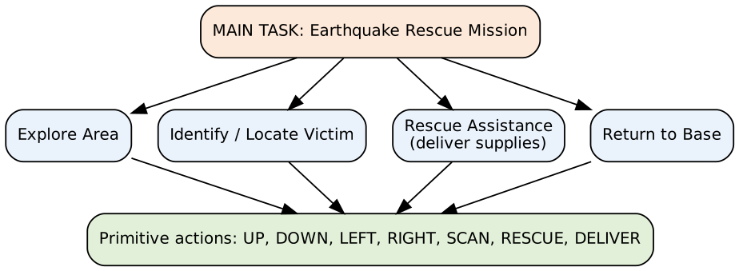
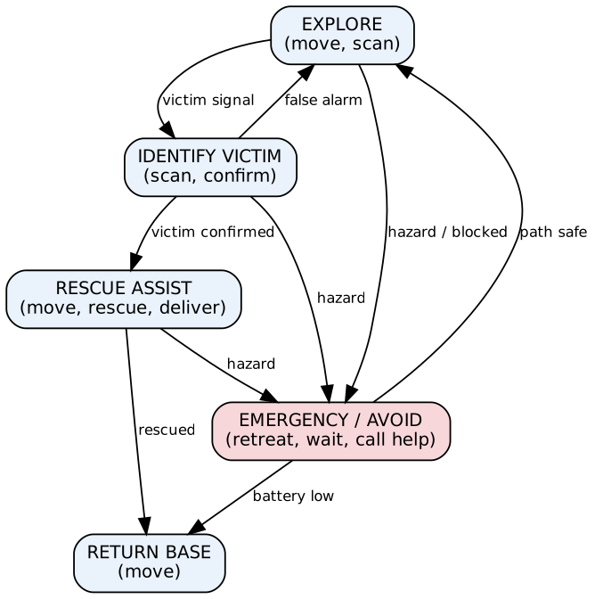

# Task A1 – Hierarchical RL for Rescue Mission Planning (6 Marks)


## A1.1 Hierarchical Task Decomposition
- **Main task:** Complete earthquake rescue mission.
- **Subtasks:** Explore area → Identify victim → Rescue assistance (deliver supplies) → Return to base.
- **Primitive actions:** UP, DOWN, LEFT, RIGHT, SCAN, RESCUE, DELIVER_SUPPLY, WAIT.



**Why decomposition helps:** each subtask has a small state/action set and a short horizon, so credit assignment is easier; subtask policies are reusable (e.g. Navigate in flood or fire); exploration is guided by subgoals; the high-level policy chooses among 4 subtasks instead of long action sequences.


## A1.2 Hierarchical Abstract Machine (HAM)
| Machine state | Allowed actions | Transition condition |
|---|---|---|
| EXPLORE | Move (4 dirs), SCAN | victim signal → IDENTIFY; hazard/blocked → EMERGENCY |
| IDENTIFY VICTIM | SCAN, confirm, report | confirmed → RESCUE; false alarm → EXPLORE |
| RESCUE ASSIST | Move, RESCUE, DELIVER_SUPPLY | victim rescued → RETURN BASE; hazard → EMERGENCY |
| RETURN BASE | Move | at base → STOP |
| EMERGENCY / AVOID | Retreat, WAIT, call help | path safe → previous state; battery low → RETURN BASE |



**Unexpected obstacles / emergencies:** any machine state can call the EMERGENCY machine (choice point). The robot retreats to a safe cell, re-plans and resumes the interrupted state; the learner only chooses at choice points, so the HAM constrains the policy space.


## A1.3 Flat Q-learning vs Hierarchical RL
| Aspect | Flat Q-learning | Hierarchical RL |
|---|---|---|
| Learning complexity | One large table; long horizon | Several small policies; short horizons |
| Action selection | Primitive action from Q(s,a) every step | Subtask chosen first, then primitive action inside it |
| Task reuse | None | Subtask policies reused across missions |
| Scalability | State space grows exponentially with features | Grows roughly additively per subtask |
| Policy performance | Slower convergence, may be optimal | Faster convergence; optimal only if hierarchy is suitable |


## Alternative Concept & Complexity (flat Q-learning)
Flat state s = (position, victim_found, rescued, supplies, battery); policy = argmax_a Q(s,a) over primitive actions. With N cells and k binary flags, |S| = N·2^k.

|  | Flat Q-learning | HRL (K subtasks) |
|---|---|---|
| Space | O(|S|·|A|) | O(Σᵢ |Sᵢ|·|Aᵢ|), |Sᵢ| ≤ N |
| Time per update | O(|A|) | O(|Aᵢ|) + high-level O(K) |
| Episodes to learn | Depends on full horizon T | Depends on subtask horizon Tᵢ ≪ T |


## Pseudocode – task selection
```
function SELECT_SUBTASK(state):
    (pos, victim_found, rescued, at_base) = state
    if rescued:            return RETURN_TO_BASE
    if not victim_found:   return EXPLORE
    return RESCUE

while not done:
    task = SELECT_SUBTASK(state)
    action = epsilon_greedy(Q[task], state)
    state, reward = env.step(action)
    update Q[task] using TD target (+ subgoal bonus on completion)
```

