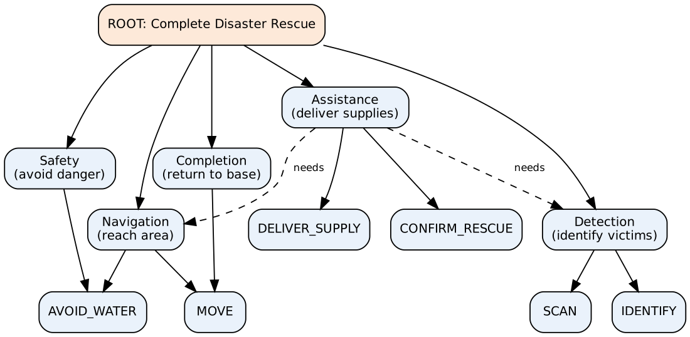

# Task A2 – MAXQ-Based Hierarchical Rescue Task Execution (5 Marks)


## A2.1 MAXQ Task Hierarchy


| Type | Tasks |
|---|---|
| Composite | Root (Complete Rescue), Navigation, Detection, Safety, Assistance, Completion |
| Primitive | MOVE, AVOID_WATER, SCAN, IDENTIFY, DELIVER_SUPPLY, CONFIRM_RESCUE |
| Dependencies | Assistance needs Detection (victim identified) and Navigation/Safety (safe route verified); Completion needs Assistance |


## A2.2 MAXQ Value Function  Q(i,s,a) = V(a,s) + C(i,s,a)
| Subtask | V(a,s) | C(i,s,a) | Q = V + C |
|---|---|---|---|
| Navigation | 5 | 3 | 8 |
| Victim Detection | 8 | 4 | 12 |
| Medical Assistance | 10 | 6 | 16 |

**Preferred subtask:** Medical Assistance (highest Q = 16). **Completion function** C(i,s,a) is the expected reward for finishing parent task i after subtask a ends; it lets the root choose the next activity by how much reward remains after the current one (e.g. delivery after detection).


## A2.3 MAXQ vs HAM
| Aspect | MAXQ | HAM |
|---|---|---|
| Task decomposition | Task graph with subgoals | Finite-state machines with choice points |
| Execution control | Parent calls child subtasks | Machine states restrict actions |
| Value estimation | V + C decomposition per subtask | Q over (machine state, env state) |
| Policy learning | Recursively optimal | Hierarchically optimal |
| Reusability | High (subtask value functions) | Moderate (machine specific) |

**Choice:** MAXQ – the flood mission has dependent subtasks and benefits from reusable value decomposition and state abstraction.


## Alternative – flat Q-learning
A single Q(s,a) over all primitives replaces V+C per subtask. Memory O(|S||A|) vs MAXQ O(Σ over subtasks of stored V,C with abstracted states); flat needs one update per step, MAXQ updates along the call stack (O(depth)) but converges faster through reuse.


## Pseudocode – subtask execution (MAXQ-0)
```
function MAXQ(i, s):
    if i is primitive: execute i; observe r; V[i,s] += a*(r - V[i,s]); return 1
    count = 0
    while not terminated(i, s):
        a = epsilon_greedy over children of i using Q(i,s,a)=V(a,s)+C(i,s,a)
        N = MAXQ(a, s); s' = current state
        C[i,s,a] += alpha*(gamma^N * max_a' [V(a',s') + C[i,s',a']] - C[i,s,a])
        s = s'; count += N
    return count
```

