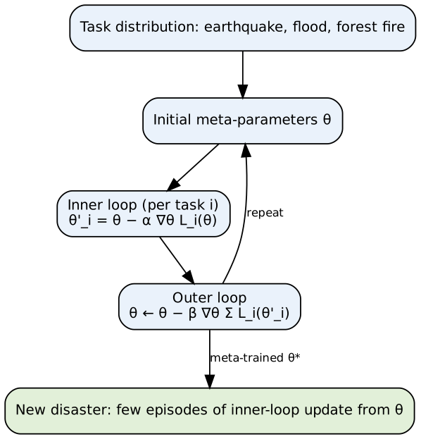

# Task A3 – Meta-Learning for Adaptation to New Disaster Environments (5 Marks)

## A3.1 Disaster Task Identification
| Environment | Hazards / constraints | Specific requirement |
|---|---|---|
| Earthquake | Collapsed buildings, blocked paths | Obstacle avoidance, victim ID |
| Flood | Waterlogged roads | Safe route, water-level assessment |
| Forest fire | Fire zones, rapidly changing hazards | Hazard avoidance, emergency navigation |

- **Common knowledge:** navigation, avoiding danger, locating victims, reward structure (rescue +, hazard −), battery management.
- **Environment-specific:** obstacle layout (earthquake), water level (flood), fire spread dynamics (forest fire).
- **Reuse:** shared parameters/features initialise the policy; only a few gradient steps specialise it.

## A3.2 MAML-Based Adaptation
Inner loop: θ'ᵢ = θ − α ∇θ L_Tᵢ(θ).   Outer loop: θ ← θ − β ∇θ Σᵢ L_Tᵢ(θ'ᵢ).

- **Learning θ:** sample disaster tasks Tᵢ, adapt, and update θ so that adapted parameters perform well.
- **Inner loop:** a few gradient steps on episodes from one disaster give task-specific θ'ᵢ.
- **Outer loop:** differentiates the post-adaptation loss, so θ becomes a good starting point.
- **New environment:** a few episodes of the inner update from θ* are enough.

## A3.3 Evaluate Adaptation Approaches
| Approach | Initialisation | Adaptation cost |
|---|---|---|
| From scratch | Random | Highest (many episodes) |
| Transfer learning | Weights from one source task | Moderate; fine-tunes all weights |
| Meta-learning | Meta-trained θ* | Lowest; fast few-shot adaptation |

**Measures:** adaptation episodes, cumulative reward, convergence time, rescue success rate.

## Alternative – transfer learning
Initialise from a network trained on one source disaster, then fine-tune on the target. Training cost O(E·P) per fine-tune (E episodes, P parameters); MAML needs second-order or first-order meta-gradients, O(P) extra memory per inner step, but cheaper adaptation to each new task.

