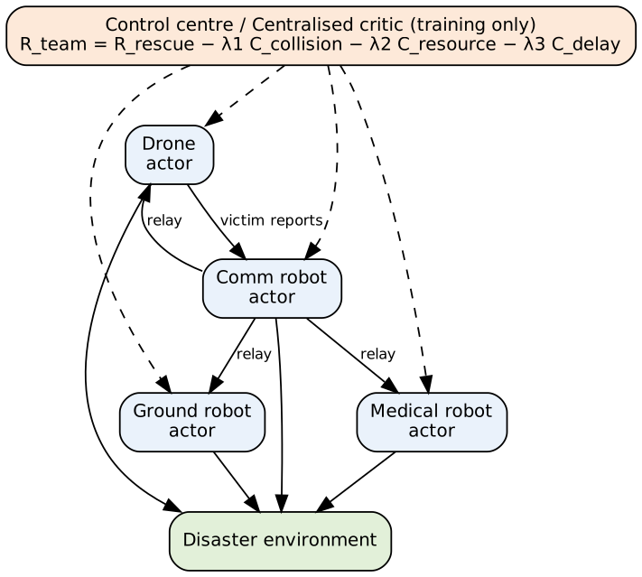

# Task A4 – Multi-Agent RL for Cooperative Disaster Rescue (5 Marks)

## A4.1 Multi-Agent Environment Design
| Agent | State | Actions | Reward | Objective |
|---|---|---|---|---|
| Surveillance drone | Camera obs, zone status, detected victims | Scan, move, report | + new victim found | Identify victims |
| Ground rescue robot | Position, obstacles, victim location | Move, avoid, rescue | + rescue, − hazard | Reach victims safely |
| Medical supply robot | Supply level, location, demand | Deliver, collect, return | + supply delivered | Distribute supplies |
| Communication robot | Agent status, network, alerts | Send, receive, coordinate | + message delivered | Maintain communication |

**Information sharing:** the drone sends victim reports to the communication robot, which relays assignments to the ground and medical robots; each victim/zone is assigned to one agent, which avoids duplicate work.

## A4.2 Cooperative Learning – CTDE
Chosen: Centralised Training with Decentralised Execution. A centralised critic sees all states/actions during training; each agent's actor uses only local observations at execution.

R_team = R_rescue − λ₁C_collision − λ₂C_resource − λ₃C_delay

All agents receive R_team, so an agent gains only when the team gains: collisions, wasted resources and delay are penalised, which pushes agents to take different zones and finish sooner.

## A4.3 Coordination Evaluation
Metrics: rescue completion time, victims rescued, collision rate, medical resource utilisation, communication efficiency (messages per rescue). **Justification:** CTDE handles non-stationarity during training and needs no central controller at run time, which suits unreliable networks.

## Alternative – Independent Q-learning vs CTDE
| Aspect | Independent Q-learning | CTDE |
|---|---|---|
| Learning | Each agent learns own Q, treats others as environment | Centralised critic, decentralised actors |
| Coordination | Weak; non-stationary | Strong |
| Communication | None needed | Only during training |
| Scalability | O(N·|S||A|) – linear in N | Critic input grows with N (joint action |A|ᴺ for tabular) |
| Computation | Low | Higher training cost |

