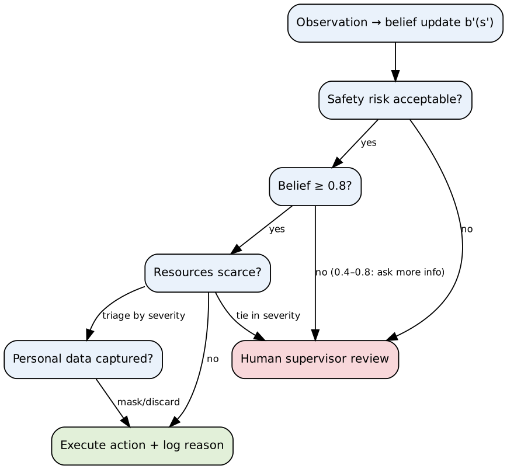

# Task A5 – POMDP and Ethical Decision-Making (4 Marks)


## A5.1 POMDP Modelling  (S, A, T, R, O, Z, γ)
| Element | Definition |
|---|---|
| S | Actual victim locations, hazard levels, environment conditions |
| A | Scan, move, rescue, deliver supplies, request assistance |
| T(s'|s,a) | Probability of environmental change (water rise, fire spread) after action a |
| R | + successful rescue, + safe operation, − hazard entry, − delay |
| O | Camera images, sensor readings, communication alerts |
| Z(o|s',a) | Probability of observation o given true state s' |
| γ | Discount factor (0.9–0.99) |

Belief update: b'(s') = η Z(o|s',a) Σₛ T(s'|s,a) b(s). With prior b = [0.6, 0.4] and Z = [0.8, 0.3]: unnormalised = [0.48, 0.12], η = 1/0.60, b' = [0.8, 0.2]. The belief about the victim location sharpens as noisy observations arrive.

```
function UPDATE_BELIEF(b, a, o):
    for each s' in S:
        b'[s'] = Z(o | s', a) * sum_s T(s' | s, a) * b[s]
    eta = 1 / sum(b')
    return eta * b'
```


## A5.2 Ethical RL Evaluation
| Situation | Ethical principle | Decision |
|---|---|---|
| 1. Two victims, one supply unit | Fairness | Triage by severity/need; tie → human supervisor; log reason |
| 2. Fast route through hazard | Safety | Reject routes above risk threshold; take safer route |
| 3. Drone captures personal data | Privacy | Collect only needed data; mask/discard; secure storage |
| 4. Uncertain victim information | Transparency + supervision | Act on belief; ≥ 0.8 rescue with notification; else gather more data / human confirmation |



**Framework priorities:** safety > fairness > privacy > transparency, with human supervision for ties and ambiguous cases.


## Alternative – MDP instead of POMDP
| Aspect | MDP | POMDP |
|---|---|---|
| State | True state known | Belief vector over states |
| Decision | π(s) | π(b) |
| Computation | No belief update | Belief update O(|S|²) per step |
| Memory | O(|S|) | O(|S|) belief + observation model O(|S||O||A|) |
| Incomplete info | Cannot handle | Handles via belief |

